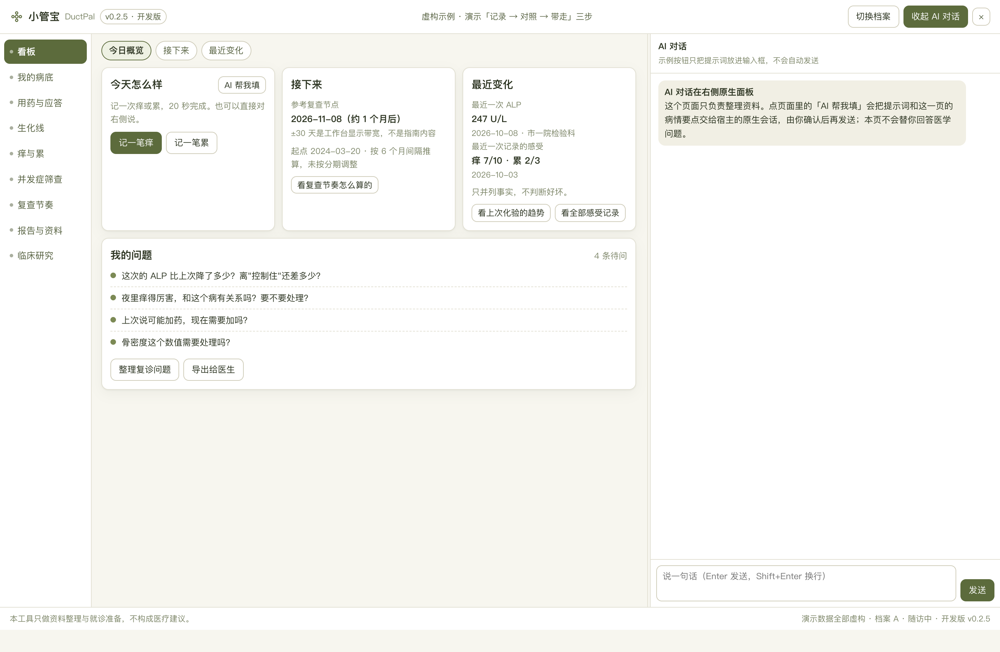
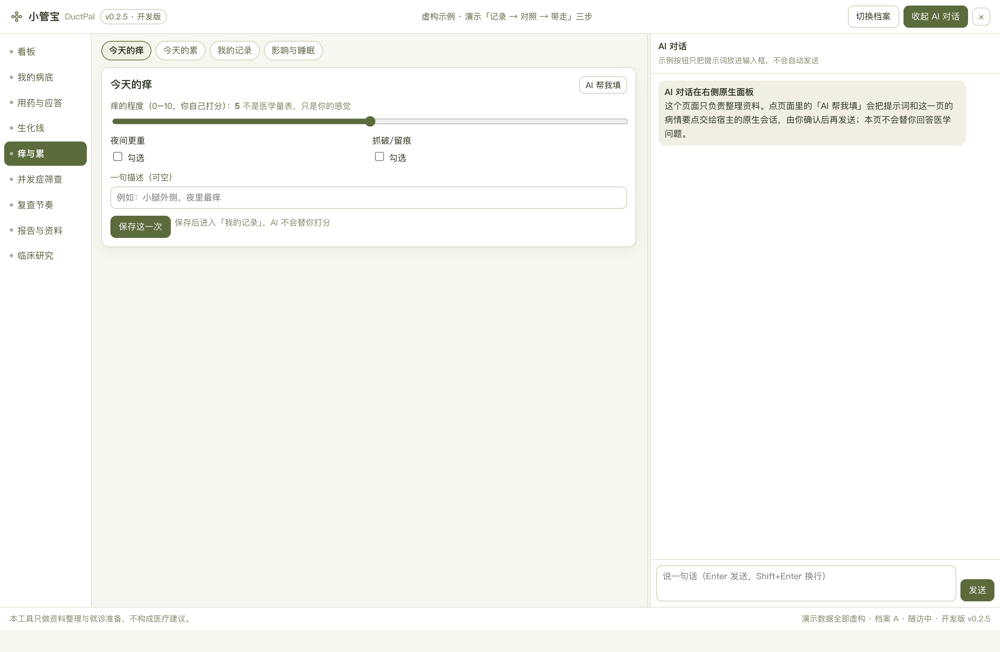
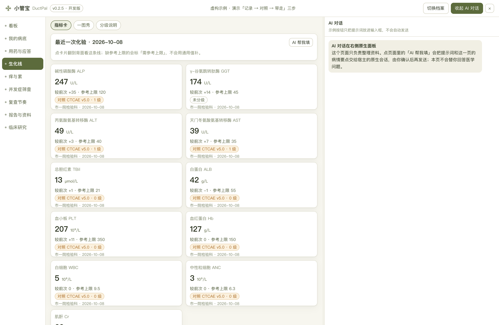
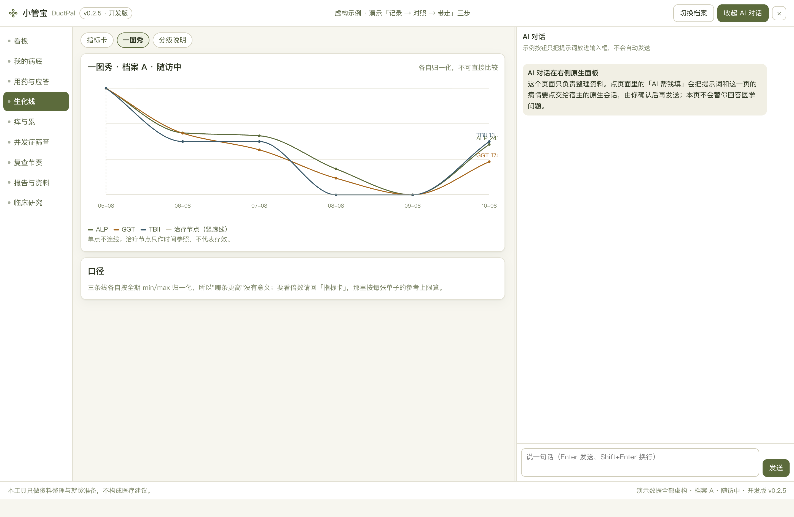
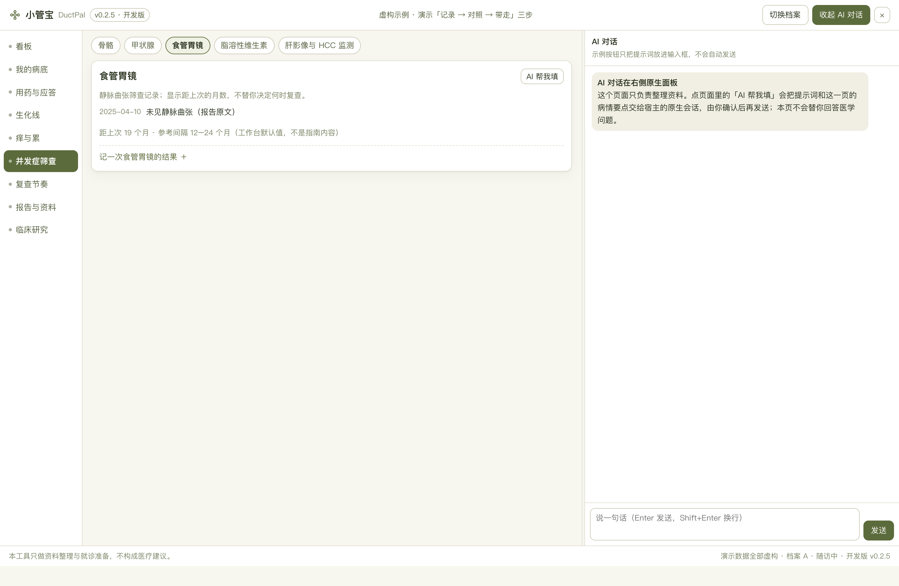
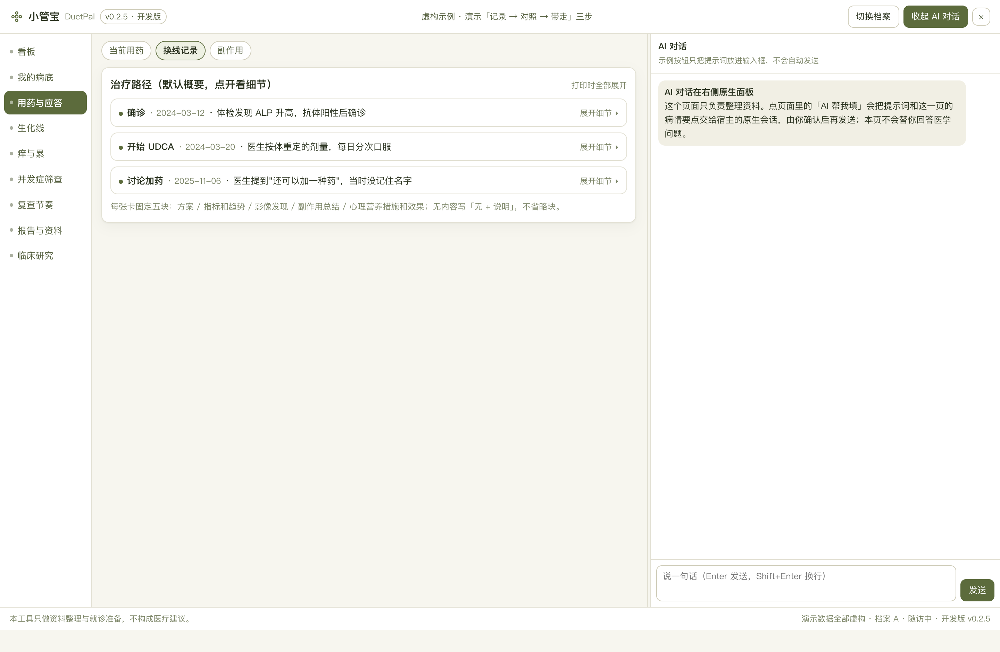
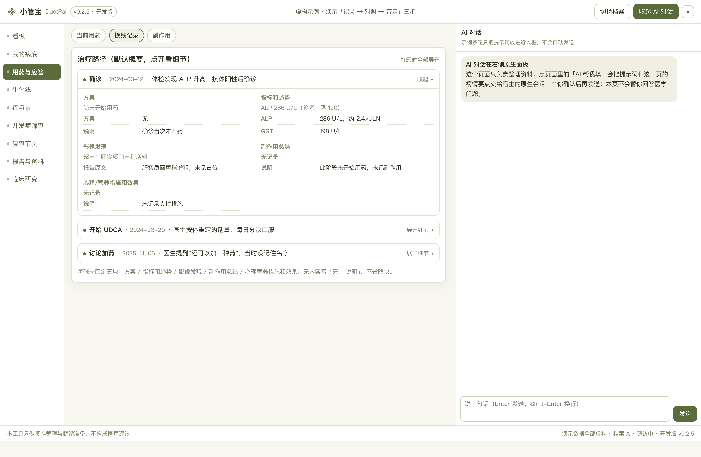

# 小管宝 DuctPal · 原发性胆汁性胆管炎（PBC）患者工作台

> 把散落的生化化验、用药与漏服、痒与累、并发症筛查整理成**可核对、可回溯、带得去门诊**的资料。
> 本机优先（数据只落用户资料目录），不做诊断、不做治疗建议、不做分期分级判定。


<details>
<summary><b>? 疾病概要</b>（定义 · 规范与指南 · 治疗全景 · 发展趋势；看板 ? 图标弹窗待各仓自行迭代落地）</summary>

**定义**：原发性胆汁性胆管炎（PBC）：慢性肝胆疾病，长期病程；本仓围绕生化化验（×ULN 口径对照单张报告参考上限）、用药与漏服、痒与累、并发症筛查整理病程。疾病定义的指南原文未取得（未核实）。

**医学资料规范和指南情况**：中文指南原件未取得（G1–G3 指南层未做，界面不出现任何指南页码，补做条件见 GUIDELINE-BRIDGE）；分级仅做 CTCAE v5.0 对照；不计算 GLOBE / UK-PBC / 巴黎 / 巴塞罗那等应答评分（属医生口径）。

**目前治疗全景概要**：以用药与依从（漏服）记录、痒与累同日记录、复诊前导出快照为主线；具体方案与判断以主诊医生为准，本仓不载剂量、不做应答判定。

**发展趋势**：指南层待原件取得后接入；临床试验库本轮 2/6 通道查过（479 条，ictrp 命中被截断），其余通道如实记「未查过」；本仓不载疗效信息。

以上为公开资料的整理性概要，不构成诊断或治疗建议；版本与出处详见 [CLINICAL-DATA-2026](docs/CLINICAL-DATA-2026.md)。
</details>

## 这是什么（以及不是什么）

- **是**：一个长期病程的记录与回顾工具。核心闭环 = *一次化验 → 看到与这张单子参考上限的对照 → 同日记一次痒/累 → 复诊前导出快照*。
- **不是**：不是病历系统、不是用药建议器、不是"应答判定器"。分级只做 **CTCAE v5.0 对照**，
  不计算 GLOBE / UK-PBC / 巴黎 / 巴塞罗那等应答评分（属医生口径）。

## 当前状态（如实标注）

| 项 | 状态 | 说明 |
| --- | --- | --- |
| M0 骨架 + 接线 | ✅ | `npm run check` → `staticPass: true, errors: []`；`config.root` 注入与声明双向齐 |
| M1 调研 / 规格 / 交互路径 | ✅ 文档完成，**待 G1 签认** | 9 一级 / 30 二级；一级重名率 **11.1%**（1/9） |
| 用户研究 | ⛔ **0 访谈** | 场景中"患者原话"全部是**改写句（假设）**，不是一手引语 |
| 指南出处层（G1–G3 指南部分） | ⛔ 未做 | 中文指南原件未取得 → 界面**不出现**任何指南页码 |
| HTML 原型（视觉基准） | ✅ 冻结在 v0.1.0 | `probe-prototype.py` 全绿：9 一级 / 30 二级无空视图、趋势图 3 条线、折叠卡 3 张默认收起 |
| 开发版（接真接口） | ✅ | `probe-dev.py` 全绿：同一套界面接上 SQLite 后仍然对 |
| 数据模型冻结 | ✅ | 24 张表、0 判读列、`0001` sha256 钉住；`check-schema` 每次 check 都核 |
| 临床试验库 | ✅ **2/6 通道查过，4 通道如实未查** | 479 条；`ictrp` 命中被截断已落 `truncated`。**不是"共 479 项相关试验"**，`research/pbc-cancer/README.md` 有逐来源终态表 |
| 装机（包层） | ✅ | 0.2.5 已装进 `~/.dsh/profiles/desktop`，副本与 tgz 逐文件一致 |
| 装机（界面层 / 真机） | ⏳ **未验证** | 需重启 Harness 后在左侧新建会话再打开工作台；ACC-04 以后全部未验 |
| 独立评审 | ✅ 已回收并处理 | P0 3 条全部修复并反向验证（`docs/DESIGN-REVIEW.md` 附开发者处理记录） |
| 发布 | ⏳ | M7 |

> **没有实测就不写"通过"。** 上表每一行的状态都对应一个可复跑的判据（`npm run check` / 两个探针 /
> `npm run audit` / `research/pbc-cancer/README.md` 的终态表）。**唯一没验的是宿主界面层**，
> 需要用户重启 Harness，我不代劳也不假装验过。

## 它长什么样

界面截图全部来自**跑起来的开发版**（真 dev-server、真 SQLite，不是画的原型图）；图里右上角的版本 chip
就是这份代码的版本，与 `package.json` 同源。


**看板**——"这周我该做什么"是复诊前最常问自己的一句话；卡片只放"能点进去的"，不放装饰。


**记一次痒**——"痒到什么程度"只有本人才说得准，所以是 0–10 的自评滑条，不是医学量表；固定写着"AI 不会替你打分"。


**生化卡**——同一个指标在同一行里并排"这次的值 / 这张单子自带的上限 / 倍数"。上限逐条来自报告，**缺上限就显示"需参考上限"，绝不借通用值**。


**生化线**——ALP/GGT/总胆红素三条线各自归一化到自己的刻度，治疗节点画竖虚线；**不做趋势预测**。


**并发症筛查**——骨密度 / 甲状腺 / 胃镜 / 维生素 / 肝影像五节，每节只记"报告原文 + 日期"，不推断该不该查。


**治疗方案（收起态）**——长期病程里病历越攒越厚，默认只给你看"方案 + 一句概要"，要细节再展开。


**治疗方案（展开态）**——方案 / 指标与趋势 / 影像发现 / 副作用 / 心理营养，五块固定顺序；打印时自动全部展开（`@media print`）。

## 三条产品底线

1. **原型是唯一视觉基准**，开发版与它逐字符对齐（`public/` 差异只允许字号三处 / `[hidden]` / dev-only）。
2. **数据只有一个来源**：`demo/build-demo-data.mjs` 同时产出 `demo/demo-data.sqlite` 与 `prototypes/v0.2/demo-data.js`。
3. **判定权归医生**：所有判定类字段不落库（无 `diagnosis` / `risk_level` / `response` / `stage` 列），
   界面只并列"指南/标准怎么写的"与"你的记录是什么"。

## 文档入口

| 文档 | 作用 |
| --- | --- |
| [SPEC](docs/SPEC.md) | 范围与不做、ADR |
| [DEV-REQUIREMENTS](docs/DEV-REQUIREMENTS-2026-10-25.md) | 强约束（每条带错误来源）+ 我替你定的默认值 |
| [DIFF-MATRIX](docs/DIFF-MATRIX.md) | 与乳腺基准/宫颈样板的差异 + 重名率实测 |
| [SCENARIOS](docs/SCENARIOS.md) | S01–S16（患者原话=改写假设 / 页面接住 / 明确不做什么） |
| [PATIENT-FLOW](docs/PATIENT-FLOW.md) | 三条真实时刻 → 页面树反推 |
| [INTERACTION-DESIGN](docs/INTERACTION-DESIGN.md) | 16 条场景路径 + CRUD 双通道 + IP1–IP10 |
| [METRIC-GRADING](docs/METRIC-GRADING.md) | 启用哪些 CTCAE 项、为什么不做瘙痒分级 |
| [GUIDELINE-BRIDGE](docs/GUIDELINE-BRIDGE.md) | 四问筛结论：**指南层本轮未做**及补做条件 |
| [CLINICAL-DATA-2026](docs/CLINICAL-DATA-2026.md) | 试验库口径与缺口（未查过就写未查过） |
| [DEV-PLAN](docs/DEV-PLAN.md) | 里程碑唯一进度表（✅/🔧/⏳） |

## 开发与验收

```bash
npm run check        # 语法 + 装包合同 + 宿主注册契约
npm run test         # 单测（M3+ 起补齐）
npm run audit        # 家族一致性（fail 不交付）
npm run release:check
```

需要 Node.js 22+。宿主 peers 范围只是模板基线，以目标 Desktop 实际依赖为准。静态检查绿 **不代表**已装进 Desktop。

## 医学免责

本工具只做**信息整理与就诊准备**，不构成医疗建议，不替代医生判断。所有数值与结论以原始报告与主诊医生意见为准。
